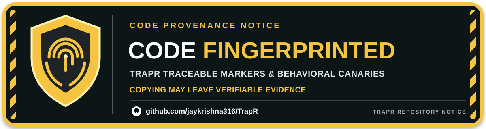

<p align="center">
  
  <br>
  <sub>Built by <a href="https://www.linkedin.com/in/jayakrishnaichapurapu/">Jayakrishna Ichapurapu</a> · <b>Primeape94 Lab</b> · MIT License</sub>
</p>


# TrapR

**Plant traceable fingerprints in your open-source code, then hunt for copies, with your own CLI or with an AI agent.**

[](https://github.com/jaykrishna316/TrapR/actions/workflows/ci.yml)
  

Mapmakers used to draw fake "trap streets", roads that don't exist, to prove when someone copied their map. **TrapR** does the same for code.

> **Coming soon:** TrapR as an **MCP server**, so Claude Code, Cursor and other agents can run `verify`, `similarity`
> and `hunt` as tools, and the TrapR gate and hunt **Actions on the GitHub Marketplace** for one-click setup.
> ⭐ Star or watch the repo to hear when they land.

## Protect your repo in one minute

Pick whichever way suits you. The tool always runs from **outside** your repo, so nothing of it stays behind.

**1. Ask your AI coding agent** (Claude Code, Codex, Cursor, Devin…)
> Set up TrapR on this repo using github.com/jaykrishna316/TrapR

The agent follows [`AGENTS.md`](AGENTS.md): it confirms the license, runs a dry run, protects the repo, helps wire in the canaries, and tells you where your vault is.

**2. One file, no install**
```bash
curl -fsSLo ~/trapr.py https://raw.githubusercontent.com/jaykrishna316/TrapR/v0.5.2/trapr.py
cd ~/code/my-project
python3 ~/trapr.py protect --license MIT --owner "Your Name"
git diff --stat                     # review, then commit and push
```

**3. As a command**
```bash
pip install git+https://github.com/jaykrishna316/TrapR      # or: pipx install git+https://github.com/jaykrishna316/TrapR
trapr protect --license MIT --owner "Your Name"
```

Add `pip install tree-sitter tree-sitter-language-pack` for AST fingerprints in non-Python repos.

One command does everything:

| What it plants or records | Where it goes |
|---|---|
| A signed marker comment in every source file, e.g. `# rev: 565e0bf5-1a2b3c4d` (label varies per project) | your repo |
| SPDX license headers (optional) | your repo |
| **3 behavioral canaries** (up to 4), each a different kind of useful helper (rollout bucket, colour index, shard router, checksum) with secret constants | your repo, spread over core files |
| Structural fingerprints of every file (token + AST winnowing) | the vault |
| Search queries, marker table, canary probes, secret key | the vault |
| **A playbook any AI agent can follow to hunt for copies** | the vault |
| A secret-free **commitment**, timestamped in Bitcoin via OpenTimestamps | next to the vault (`.trapr-commitment.json` + `.ots`) |

The **vault** is a single Markdown file written *outside* your repo (`../neo.trapr-vault.md`). Keep it private.

## Hunting for copies

**Option A: let an AI agent do it.** Open the vault in Claude Code (or any agent with GitHub access) and say:

> Follow the playbook in this file.

The vault tells the agent which lines to read, which searches to run (`gh`, GitHub search, grep.app), how to verify each hit, how to grade the evidence, what not to do (never run suspect code, never leak the vault), and the exact report format to return.

**Option B: the CLI.**
```bash
trapr hunt   --vault neo.trapr-vault.md            # GitHub code search + forks + PyPI + npm, verifies every hit
trapr verify --vault neo.trapr-vault.md <target>   # a file, folder, git URL, or GitHub file URL
trapr refresh --vault neo.trapr-vault.md --repo-dir ~/code/neo   # after big changes (same key)
trapr mark    --vault neo.trapr-vault.md --repo-dir ~/code/neo   # another branch, same key
trapr similarity --repo-dir ~/code/neo --target <folder|git URL>  # lead finder, works across languages
```
`similarity` compares your code with a suspect even after a port to another language: keywords map to neutral
tokens and distinctive string and number literals are compared separately. It returns a lead for review, never
proof. Calibrated on 36 unrelated repo pairs with 0 false leads; it misses short ports that share only one or two
distinctive literals.
`hunt` searches four places: GitHub code search, your **fork network** (forks aren't in code search; it flags forks that
removed your LICENSE or stripped markers), and **PyPI and npm** packages with similar names, downloaded and scanned
safely, never installed. Code search and forks need `GITHUB_TOKEN` or a logged-in `gh`; registries need nothing.
Pick sources with `--sources code,forks,pypi,npm`.

**Option C: every week, automatically, with an email.** Keep your vaults in one **private** repo and add the workflow from
[`examples/vaults-repo`](examples/vaults-repo/.github/workflows/trapr-hunt.yml):

```yaml
- uses: jaykrishna316/TrapR@v0.5.2
  with:
    vaults: "vaults/*.trapr-vault.md"
    search-token: ${{ secrets.TRAPR_SEARCH_TOKEN }}   # fine-grained PAT, public read
```

On your schedule (the example runs every Sunday) it hunts with **every vault in the repo**, so a new project is
covered as soon as you add its vault. It writes **one report per project**, uploads them, and comments on a single
**"TrapR weekly hunt"** issue with a row per project, all clear or not. When there's definitive or strong evidence it
also opens a separate issue. GitHub emails both to you, so a quiet week still lands in your inbox.

Your tokens stay put: the search token goes only into API request headers, never into logs, reports or issues,
and the issues are posted with the repository's own `GITHUB_TOKEN`. The action refuses to run in a public
repository, because vaults hold secret keys.

## Did an AI model learn your code?

```bash
trapr probe-models --vault neo.trapr-vault.md                                  # every local Ollama model
trapr probe-models --vault neo.trapr-vault.md --provider openai --model <model>  # any OpenAI-compatible API
trapr probe-models --vault neo.trapr-vault.md --provider anthropic --model <model>
```

Each model sees only a canary's signature and docstring and is asked to finish it. Its answer runs on the six secret
probes. Without having seen your code, the chance of matching all six is about 1 in 2^186, so a match is definitive:
the model saw your code in training, or fetched it live. A miss proves nothing; most models won't memorize one repo.
Works with Ollama, LM Studio, vLLM, OpenRouter, OpenAI, Groq, Anthropic, and anything OpenAI-compatible (`--base-url`).

## Prove when your traps existed

`protect` hashes everything the vault can prove (marker tags, fingerprint hashes, canary specs, a hash of the key)
into a commitment and anchors it in Bitcoin through [OpenTimestamps](https://opentimestamps.org). The commitment
reveals nothing, so you can publish it. A few hours later, `ots upgrade` and `ots verify` (from
`pip install opentimestamps-client`) prove the date to anyone. `trapr timestamp --vault … --swh` re-stamps and asks
[Software Heritage](https://archive.softwareheritage.org) to archive your public repo as an independent witness.

## Keep it current: the merge gate

Every new file should carry a build reference before it reaches main. Two pieces, and your public repo never
holds the key:

1. In the protected repo, add the check `trapr gate-workflow` prints and make **trapr-gate** a required
   status check. It fails while any source file lacks a build reference.
2. In your private vaults repo, add [`trapr-sync.yml`](examples/vaults-repo/trapr-sync.yml) and
   [`trapr_sync.py`](examples/vaults-repo/trapr_sync.py), list your repos in `trapr-sync.json`, and give it a
   fine-grained token with write access to them. When the gate fails, the sync marks the pull request's
   branch with a comment-only commit and the check passes. It also keeps the vault's fingerprints current.

```bash
trapr gate-workflow --vault neo.trapr-vault.md --vaults-repo you/trapr-vaults --branch main > .github/workflows/trapr-gate.yml
```
Pull requests from forks can't be marked by the bot (it can't push to someone else's fork): mark those
locally with `trapr mark` before merging.

**TrapR protects itself.** The `# build-id: 8113f5bb-…` line at the top of `trapr.py` is TrapR's own marker, and this
repo runs the same gate. It's a comment: copying TrapR under the MIT license is fine, just keep the attribution.

## Five layers of evidence

| Layer | Survives | Grade when it fires |
|---|---|---|
| **Signed marker**: HMAC of the file path under your key | copy-paste, forks, moved files | 🔴 Definitive |
| **Canary behavior**: 6 secret probes → 6 secret outputs per canary (≈1 in 2^186 by chance) | renaming, restyling, `reduce`/`forEach`/`while` rewrites, class methods with class constants, **porting to another language**, broken imports around it | 🔴 Definitive |
| **Canary constants**: each canary's secret constants, hex or decimal | rewrites that keep the math | 🟠 Strong |
| **Token winnowing**: MOSS's algorithm over normalized tokens | renamed identifiers, stripped comments/markers, reordering | 🟠 Strong ≥60% · 🟡 Moderate ≥35% |
| **AST winnowing**: tree shapes in language-neutral classes | `for`↔`while`, `+=`↔`= x +`, reformatting | same as above |

**Make the canaries load-bearing.** `protect` prints an import and a real use for each (a rollout check, an avatar colour, a worker pick, an ETag). Wire them in, so a copier can't delete them without breaking their code, and has to find and rewrite every one.

## Tested on Neo and Braxis

Retested on 2026-11-08 with v0.4.1, on fresh clones of Neo (`main`, 283 files protected) and Braxis (61 files),
3 canaries each.

| Copier did this | Result |
|---|---|
| Copied 2 Neo files verbatim | 🔴 2/2 definitive (markers) |
| Copied all 54 files of Neo's `core/`, stripped every marker and SPDX line | 🔴 1 definitive (canary) + 🟠 51 strong; the 2 misses are 13-line `__init__.py` files |
| Took the 3 Neo files carrying canaries, stripped markers (their imports don't resolve elsewhere) | 🔴 3/3 definitive, each by its own canary |
| Rewrote 3 Neo files with the AST: 37–87 identifiers renamed per file, docstrings and comments removed, reformatted | 🟠 3/3 strong (83–95% structural match) |
| Reimplemented each of Neo's 3 canaries by hand: a JavaScript port using `forEach`, a class method with class constants, a `while` loop, all with decimal constants | 🔴 3/3 definitive (6/6 probes each) |
| Took only `braxis.py`, stripped markers | 🔴 definitive (canary + 100% structure) |
| Prepended a booby-trapped `open("PWNED")` to a copied Neo canary file | 🔴 Caught. **The trap never ran.** |
| **False positives:** itsdangerous, uvicorn, rich, requests, click, typer, httpx, attrs, structlog, pip-tools, checked against both the Neo and Braxis vaults | **0 flagged across 20 checks.** Closest unrelated file: 32%, against a tiny archived Neo test fixture; every other file 13% or less (threshold 35%) |
| Neo and Braxis test suites after `protect` | Identical to before (Neo: 183 passed; Braxis: 26 passed; the same pre-existing failures on both sides) |
| **Registries, live:** pretended to own `itsdangerous` and `@sindresorhus/slugify` | The real PyPI and npm packages flagged (12 and 2 files, 100% match); 9 lookalikes such as `types-itsdangerous`, `more-itsdangerous`, `slugify` and `react-slugify` not flagged |
| **Model probes, live with Ollama** (`qwen2.5:3b`, `qwen3.5:4b`) on Neo's canaries | No false alarms: 6/6 probe runs cleared. Positive control: when the model was shown a canary and asked to copy it, TrapR caught 3/3, each 6/6 secret probes |
| Model probes against a server speaking the Ollama, OpenAI and Anthropic APIs | A model returning the canary: caught on every canary. A model that hadn't seen it: cleared. A model that returned no code: reported inconclusive |
| **Timestamp, live:** Neo's commitment submitted to OpenTimestamps | Accepted by all 4 public calendars |
| **Merge gate, live** on a throwaway GitHub repo: `main` requires a green `trapr-gate`, then a pull request adds an unmarked file | The check failed and named the file; the private sync marked the branch with a 3-line comment-only commit; the check passed. **34 seconds, nobody touched anything.** The key never left the private vaults repo |

Test suites: `python3 tests/test_trapr.py` (50 checks) and `python3 tests/test_similarity.py` (cross-language). The main suite covers mocked GitHub search and forks, malicious archives,
three model-API wire formats, a timestamp proof parsed by the official OpenTimestamps library, and all 1,152 canary
kind × style combinations. CI runs it on Python 3.10–3.14, with and without tree-sitter, and passes on all 10 jobs.

**Tested live:** GitHub code search finds Neo's and Braxis's markers in their own repos and nowhere else, and the
merge gate marks new files on push. **Not yet tested live:** fork crawling inside `hunt` against a real copy, and
probing cloud models.

## How verification stays safe

Checking a canary means running suspect code, so TrapR **never imports the suspect module**. It parses the file and keeps only definitions:
- functions and classes (decorators and call-containing defaults stripped)
- constants whose values make no calls
- absolute imports

Every top-level statement that would execute something is dropped. The result runs in a subprocess with a memory cap, a 2-second limit per call, an empty environment, and a temp directory. This is defense in depth, not a perfect sandbox: for unattended `hunt` runs, use a container or CI.

## Options

```
protect  --license MIT --owner "Name"     SPDX headers (omit for markers only)
         --canaries 3                     how many canaries, 0-4, each a different kind
         --canary-into path/to/file.py    put every canary in one file (default: spread over core files)
         --no-timestamp                   don't submit the commitment to OpenTimestamps
         --canary-lang auto|py|js|ts|none
         --marker-label rev               the comment label (default: picked per project)
         --include-dir .claude            also protect a hidden folder (repeatable)
         --exclude-owner myorg            extra owners to ignore in results (repeatable)
         --vault PATH                     default: ../<repo>.trapr-vault.md
         --no-markers --no-spdx --dry-run --force
hunt     --sources code,forks,pypi,npm --max-queries 40 --max-forks 300 --max-packages 15
         --pause 7                        (code search allows ~10 requests/minute)
probe-models --provider ollama|openai|anthropic --model NAME --base-url URL --samples 3
timestamp    --swh                        also ask Software Heritage to archive the public repo
```

**Dependencies:** none (Python 3.10+). Optional `pip install tree-sitter tree-sitter-language-pack` adds AST fingerprints for 18 languages and JS canary verification. Node.js is needed to run JS canary checks.

## Security model: what a copier who has read this README can do

TrapR is open source, so assume copiers know how it works. Its strength rests on your **secret key**, not on secrecy of the method:

- **Markers** use a label picked per project (`rev`, `src-ref`, `build-id`…), but the `xxxxxxxx-xxxxxxxx` pattern is greppable. Stripping them is easy; they catch the lazy majority.
- **The canary's** name, docstring, variable names and arithmetic style are chosen per project from your key, so there's no fixed string to search for. Its *shape* (a small multiply-xor hash) is still recognizable to someone who suspects it. Removing it means rewriting whatever depends on it, which is why it should be load-bearing.
- **Structural fingerprints** need no secrecy. Defeating them takes a real rewrite.
- **Without the key**, nobody can forge your markers, compute your canary's probe outputs, or prove a file is yours.

See [SECURITY.md](SECURITY.md) for the full threat model.

## Honest limits

- **Markers are visible.** A careful copier strips them, which is why the canary and structural layers exist.
- **A full reimplementation of non-canary code can get below the threshold.** Structural matching catches lazy and medium-effort disguise. The canary catches anything short of replacing the algorithm.
- **GitHub code search only finds strings.** If a copier strips markers, renames everything, and drops the canary, `hunt` won't surface them. Run `verify` on suspects you find another way (forks, similar names, PyPI/npm).
- **Lead queries** (distinctive strings and identifiers) also match legitimate users of your project. They are leads, not evidence.
- **Model probes only catch memorization or live retrieval.** A model trained on your repo but unable to recite the
  canary passes. That's the expected outcome for most models and one repo; nothing today can prove that case.
- **`hunt`'s fork crawl has only run against mocked GitHub APIs** built from the official formats (code search has
  run live); model probes have run live against Ollama, but not yet against cloud APIs. Please report problems.
- **`similarity` misses short ports** that share only one or two distinctive literals. It's precision-first on purpose.
- **The vault is large** (about 260 KB for Braxis and 790 KB for Neo) because it carries fingerprints. Agents are told to read only the first few hundred lines.
- **Lose the vault and you lose the proof.** Back it up. With `--force`, `protect` makes a new key and the old markers become unprovable.
- **MIT/Apache permit copying.** You're detecting missing attribution. This is evidence gathering, not legal advice.

## Related work

TrapR builds on decades of research and stands next to good tools. Use them too:

- **Similarity detection:** MOSS and its winnowing algorithm (Schleimer, Wilkerson & Aiken, 2003), [Dolos](https://dolos.ugent.be), JPlag, and Trail of Bits' [Vendetect](https://github.com/trailofbits/vendetect) (2025). TrapR's structural layers use the same winnowing idea.
- **Software watermarking:** Collberg & Thomborson's static and dynamic watermarks (late 1990s onward); research systems such as SrcMarker, CodeMark and CoProtector.
- **Canaries and honeytokens:** Thinkst Canarytokens, GitGuardian honeytokens, and the "AI Code Canaries" defensive publication (Technical Disclosure Commons, 2024).
- **License compliance:** ScanCode, FOSSology, and commercial snippet matchers.

What TrapR adds is the **maintainer-side workflow**: one command to plant everything, a secret-keyed behavioral canary verified safely in a sandbox, and a private vault that both a CLI and an AI agent can use to hunt for copies.

## Roadmap

- crates.io, Go modules and Maven scanning
- More canary types (string normalizers, checksums) and TypeScript behavior verification
- A cross-project vault index for one-command hunts across all your repos
- **Coming soon:** an MCP server, so AI agents can run `verify`, `similarity` and `hunt` as tools
- **Coming soon:** the gate and hunt Actions on the GitHub Marketplace
- Function-level similarity, to catch short ports the current rules miss

## Contributing

Issues and PRs welcome. The rules are in [AGENTS.md](AGENTS.md#contributing-only-if-youre-working-on-TrapR-itself): one file, zero required dependencies, tests must pass, and detection changes need false-positive numbers.

---

<p align="center">
  
</p>
